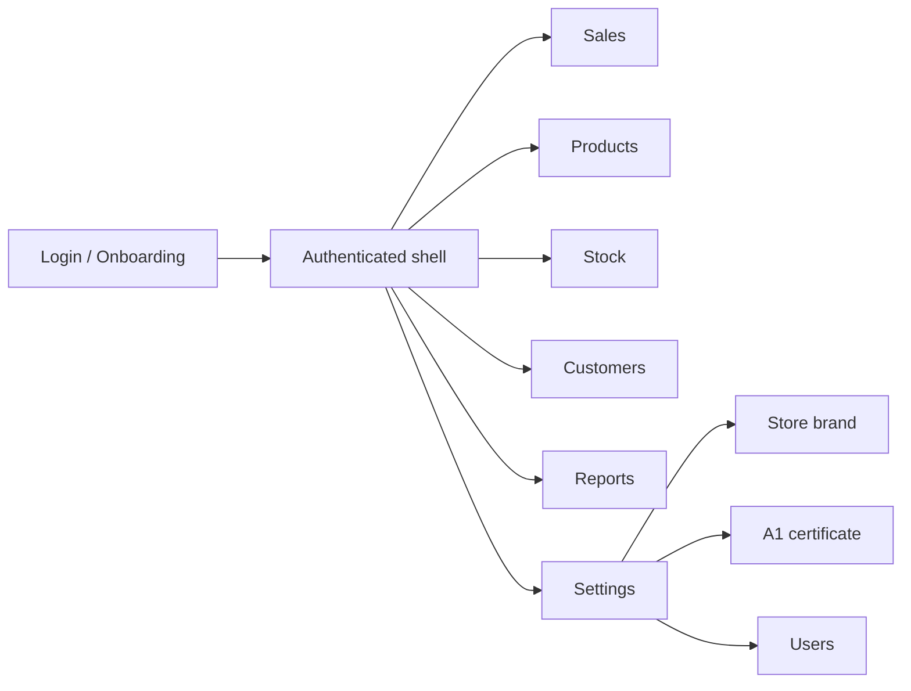

# PDV UI/UX and Design System

*Leia em português: [Português](../ui-ux.md).*

**Status:** specification approved for implementation in US-22 (foundation) and US-23 (whitelabel).
**Scope:** `desktop-client` (React + TypeScript + Tauri), light theme, pt-BR, minimum window 1024×600.
**Out of scope for now:** dark mode, i18n, fully free theme, mobile app and Figma files.
**Sibling document:** [Store whitelabel](whitelabel.md) — brand model, data, API and reseller build.

This document is normative. The words **MUST**, **MUST NOT** and **MAY** indicate a mandatory requirement, a prohibition and an option.

---

## 1. Goal

Turn the current interface — functional but raw and misaligned — into a precise counter POS:

- fast for the cashier (keyboard + scanner + touch where it makes sense);
- legible on small monitors (1024×600) and in bright environments;
- consistent across screens, states and roles;
- accessible (WCAG 2.2 AA) and predictable;
- truly whitelabel: the store changes logo, name, preset and accent **without a developer**.

The redesign is not cosmetic. It fixes checkout flow, session state, focus, barcode scanner behavior and the component foundation before new screens.

---

## 2. Context and users

| Persona | Main goal | Constraints |
|---|---|---|
| Cashier | Scan, search, close the sale and give change with minimal clicks | Rush, queue, keyboard, scanner, low error tolerance |
| Manager | Create/edit products, adjust stock, authorize exceptions (US21) | Needs managerial visibility without leaving the flow |
| Owner/administrator | Configure store, brand, certificate, users and audit | Rare access; needs clarity and safety |
| Reseller/SaaS operator | Build with their own brand and provide support | Cannot edit code per store |

**Usage environment:** bright counter, 1024×600 to 1440×900 monitor, legacy hardware (low RAM), physical keyboard, keyboard-wedge barcode scanner, optional touch, unstable internet.

**Measurable goals:**

- five-item sale completed in under 30 s by a trained operator;
- no destructive action without confirmation or undo;
- AA contrast on all text and interactive components;
- app operable with keyboard only;
- memory within the US05 target (≤ 80 MB at rest).

---

## 3. Current diagnosis

| Area | Today | Impact | Priority |
|---|---|---|---|
| Login | Store UUID typed manually, no `<form>`, autofocus or field-level error | Typing mistakes and entry barrier | P0 |
| Shell | No brand, store name, active item, page title or `aria-current` | Weak orientation; prototype feel | P0 |
| Sales | No manual search, editable quantity, discount or shortcuts; totals in flow; scanner active during payment | Slowness and wrong-sale risk | P0 |
| Payment | `role="dialog"` without overlay, focus trap, ESC or background lock | Focus escapes; scans change the cart during payment | P0 |
| Products | Creation only; no list, edit, deactivate or stock | Incomplete back office | P1 |
| Settings/Reports | Placeholders | No brand, certificate or management | P1 |
| Design system | Minimal global CSS; only `.card`, `.primary` and `.change-highlight`; no layout, table, modal or breakpoints | Every screen invents structure | P0 (foundation) |
| Whitelabel | Only token changes in `tokens.css`; name, logo, title, icon and footer hardcoded | Store cannot own the product | P0 (launch) |
| Session/state | Logout does not clear cart/checkout/screen; 401 does not drop the UI | Data leak between operators | P0 (security) |
| Tests | 74 tests depend on current texts/labels; no a11y or visual regression | Redesign breaks without a safety net | P1 |

Conclusion: the foundation (design system + shell + states) comes before new screens. The US10 certificate screen MUST be born in the new standard.

---

## 4. Design principles

1. **Clarity before density.** Essential information visible; the rest in hierarchy.
2. **Controlled density.** More fits without cramping: compact tables, 8/16 px breathing room.
3. **Keyboard-first.** Every frequent action has a shortcut; focus is always visible.
4. **Immediate feedback.** Scan, add, remove, payment and error have visual and aria/sound feedback.
5. **Error prevention.** Confirmation for destruction; undo for removal; validation next to the field.
6. **Consistency.** One component, one behavior; explicit variants.
7. **AA accessibility.** Contrast, labels, focus, screen reader and 44 px targets.
8. **Offline-first.** No remote font or icon dependency; explicit offline states.
9. **Whitelabel without code.** Store brand by configuration, with limits that preserve legibility.
10. **Performance.** No heavy libraries, web fonts or unnecessary rendering.

---

## 5. Information architecture



| Screen | Roles | Current state | Target |
|---|---|---|---|
| Login/Onboarding | public | functional | brand + preconfigured store + code |
| Sales | cashier, manager, admin | functional | search, scanner, cart, shortcuts, fixed totals |
| Products | manager, admin | creation | list, search, create/edit, deactivate |
| Stock | manager, admin | no UI | balance + adjustment with reason |
| Customers | manager, admin (cashier future) | no UI | search, PF/PJ, CPF on receipt |
| Reports | manager, admin | placeholder | US17 |
| Settings | admin | placeholder | brand, certificate, users, fiscal |

**Navigation:** typed state (`Screen`) in this phase; no router until there is a real need for deep links. The active item MUST have `aria-current="page"`. Logout MUST return to login and clear `screen`, cart and checkout.

---

## 6. Layout and shell

**Window:** minimum 1024×600; default 1280×800; maximum content width 1440 px.

**Shell:**

```text
┌──────────────────────────────────────────────────────────────┐
│ [Logo] Store name       Sales  Products  Stock  ...          │
│                                          Operator (role) ▾   │
├──────────────────────────────────────────────────────────────┤
│ Page title + primary action                                  │
│                                                              │
│ Content                                                      │
└──────────────────────────────────────────────────────────────┘
```

- 56 px top bar, bottom border, `surface-card` background.
- Brand on the left (logo + name); navigation next to it; user/menu on the right.
- Content padding of 16 px (compact) or 24 px (≥1280).
- Page title (`PageHeader`) with primary action on the right.
- No sidebar in this phase: the POS needs width for the cart.

**Sales at 1024×600:** two columns (search/catalog ~38%, cart ~62%), 16 px gap. Totals and payment button fixed at the bottom of the cart column.

```text
┌──────────────────────────────┬───────────────────────────────┐
│ Search / scan [__________]   │ Cart (3 items)                │
│ Results                      │ Item  Qty  Unit  Disc  Total  │
│ ┌──────────────────────────┐ │ Rice    2   27.99  —   55.98  │
│ │ Rice 5kg         R$27.99 │ │ Coffee  1   18.99  —   18.99  │
│ └──────────────────────────┘ │ Milk    1    5.99  —    5.99  │
│                              ├───────────────────────────────┤
│                              │ Subtotal           R$ 80.96   │
│                              │ Total              R$ 80.96   │
│                              │ [F4 Payment]  [Clear]         │
└──────────────────────────────┴───────────────────────────────┘
```

**Breakpoints:** `sm 640`, `md 768`, `lg 1024`, `xl 1280`, `2xl 1440`. Below 1024 is unsupported (window limit).

---

## 7. Design system

### 7.1 Tokens

`desktop-client/src/styles/tokens.css` remains the **source of truth** for colors, typography, spacing, radii and targets. No hex/rgb/hsl outside it. Whitelabel presets live in `presets.css` and only swap semantic values.

| Group | Tokens |
|---|---|
| Surfaces | `--surface-page`, `--surface-card`, `--surface-overlay`, `--surface-muted` |
| Text | `--text-strong`, `--text-body`, `--text-muted`, `--text-on-primary` |
| Action | `--primary`, `--primary-hover`, `--primary-soft`, `--focus-ring` |
| States | `--danger`, `--danger-soft`, `--success`, `--success-soft`, `--warning`, `--warning-soft` |
| Shape | `--radius-sm/md/lg`, `--space-1…6`, `--tap-min` |
| Typography | `--font-sans`, `--font-mono`, `--text-sm/md/lg/xl` |

**Theme:** light only in this phase. Tokens MUST be organized to allow future dark mode without rewriting components.

### 7.2 Tailwind v4

Adoption planned in US-22, without breaking whitelabel:

- `tailwindcss` + `@tailwindcss/vite` (MIT), CSS-first, no `tailwind.config.js`.
- `tokens.css` remains the source; `theme.css` maps tokens into Tailwind:

```css
@import "tailwindcss";

@theme inline {
  --color-surface-page: var(--surface-page);
  --color-surface-card: var(--surface-card);
  --color-text-strong: var(--text-strong);
  --color-primary: var(--primary);
  --radius-card: var(--radius-md);
}
```

- Semantic utilities: `bg-surface-card`, `text-strong`, `rounded-card`, `p-4`.
- Arbitrary color values are forbidden (`bg-[#...]`, `text-[rgb(...)]`).
- Arbitrary layout values only with review justification.
- Component variants with `class-variance-authority` (Apache-2.0), `clsx` and `tailwind-merge` (MIT).
- Accessible primitives with Radix UI (MIT): Dialog, Tabs, Select, Toast, Tooltip, Dropdown.
- Icons with Lucide React (ISC), 1.5–2 stroke, 16/20/24 sizes.
- System fonts; no remote web fonts (offline/CSP).

### 7.3 Typography and numbers

| Use | Size / weight |
|---|---|
| Page title | 24 px / 600 |
| Section title | 20 px / 600 |
| Body | 16 px / 400 |
| Secondary | 14 px / 400 |
| Label | 14 px / 500 |
| Micro (shortcut, badge) | 12 px / 500 |

- Money and quantity use `font-variant-numeric: tabular-nums`, right-aligned.
- BRL always with 2 decimals; quantity with up to 3 decimals (domain rule).
- Never abbreviate values in the cart/totals.

### 7.4 Spacing, shape and motion

- 4 px scale; components use 8/12/16/24.
- Radii: 6 px (control), 10 px (card), 16 px (modal/overlay).
- Minimum touch target: 44×44 px; in dense tables, 36 px is acceptable only with keyboard.
- Subtle shadows: `sm` for card, `md` for dropdown, `lg` for modal.
- `z-index`: content 0, sticky 10, dropdown 20, overlay 30, modal 40, toast 50.
- 120–180 ms transitions; respect `prefers-reduced-motion`.

### 7.5 Components

| Component | Variants / states | Rules |
|---|---|---|
| Button | primary, secondary, ghost, danger; sm/md/lg; loading, disabled | Optional icon; icon-only requires `aria-label`; loading blocks double click |
| IconButton | ghost, danger | 44×44; tooltip with shortcut |
| Input / Field | default, focus, error, disabled, readonly | Label always visible; error with `aria-invalid` + `aria-describedby`; optional hint |
| Select | default, error | Radix Select; full keyboard support |
| Dialog | sm/md/lg; destructive confirm | Overlay, focus trap, ESC, focus return, scroll lock |
| Toast | success, error, info; with action | `aria-live`; 4 s; “Undo” action when applicable |
| Table | default, compact, loading, empty | Sticky header; numbers right-aligned; row actions; virtualize >50 rows |
| Tabs | default | Radix; visible active tab; keyboard arrows |
| Badge | neutral, success, warning, danger | Short text; never rely on color alone |
| EmptyState | with/without action | Icon, title, description, CTA |
| Skeleton | text, table, card | No aggressive animation |
| Kbd | single key, combination | Used in shortcuts and hints |
| PageHeader | title, subtitle, action | Always present on authenticated screens |
| Brand | full logo, mark, text fallback | See [whitelabel](whitelabel.md) |
| StatCard | value, label, variation | Reports/dashboard |

**Mandatory states per screen:** loading, empty, error, success, no permission and offline (when applicable).

---

## 8. Screen specifications

### 8.1 Login and onboarding

**Goal:** sign in with minimal friction, with the store brand visible before authentication.

- Store preconfigured by the installer OR short code on first use (see [whitelabel](whitelabel.md)).
- Fields: email, password (with “show”), no UUID when the store is already known.
- Real `<form>`; Enter submits from any field; autofocus on email.
- Field-level error + general error in `role="alert"`; generic message for invalid credentials.
- “Switch store” clears the local store and session.
- Reseller credit footer is optional (build), not the store's.
- Offline state: shows cached brand and warns that login needs a connection.

```text
┌────────────────────────────────────────────┐
│                [Store logo]                │
│                Mercado Bom Preço           │
│  Email  [________________________________] │
│  Senha  [________________________] [show]  │
│  [ Sign in ]                               │
│  Switch store · Help                       │
│  reseller credit (optional)                │
└────────────────────────────────────────────┘
```

**Acceptance:** login with keyboard only; errors associated with fields; brand loaded before the form; no UUID visible in the preconfigured flow.

### 8.2 Shell

- Top bar with brand, navigation, user and readable role (“Manager”, not `manager`).
- Active item with `aria-current` and visual indicator.
- Logout with confirmation if a sale is in progress; clears session, cart, checkout and screen.
- No empty screens after role switch: if the current screen is not allowed, return to Sales.

### 8.3 Sales

**Goal:** scan or search, adjust the cart and close the sale without leaving the keyboard.

- Search by name/SKU/code with 250 ms debounce and minimum 2 characters.
- Scan mode vs search mode: focusing search disables global capture; ESC returns to scan mode.
- Scanner accepts alphanumeric (Code 128/EAN) and minimum 4 characters; scans are queued.
- Repeated item sums quantity; editable quantity with stepper; item/value discount per rule (US21 for high discounts).
- Remove item with toast “Undo”; clear cart with confirmation.
- Totals and “Payment” fixed at the bottom of the column; “Finish sale” does not require tabbing through every item.
- “Scan ready” indicator and `aria-live` announcement when adding item/total.
- States: empty (“Scan or search a product”), loading, product not found, insufficient stock, network error.

**Acceptance:** complete sale without a mouse; scanner does not add items while the modal is open; totals always visible; reversible removal.

### 8.4 Payment

**Goal:** accept split amounts, calculate change and finish safely.

- Real Dialog (Radix) with overlay, focus trap, ESC and focus return.
- Summary: total, paid, remaining; BRL tabular values.
- Methods: cash, PIX, credit, debit; cash requires tendered amount; change highlighted.
- “Add payment” via Enter; list with removal; “Finish” only when remaining = 0.
- Cancel with payments requires confirmation; scanner disabled while the dialog is open.
- States: processing, error, success with receipt (printing in US12).

```text
┌──────────────────────────────────────────────┐
│ Close sale                               [x] │
│ Total R$ 80.96 · Paid R$ 0.00 · Due 80.96    │
│ [Cash] [PIX] [Credit] [Debit]                │
│ Tendered [R$ 100.00]                         │
│ [Add payment]                                │
│ Payments: Cash R$ 100.00 [remove]            │
│ Change R$ 19.04                              │
│ [Cancel]                       [Finish]      │
└──────────────────────────────────────────────┘
```

**Acceptance:** focus never leaves the dialog; ESC cancels with confirmation; correct change; no double submit.

### 8.5 Products and stock

- List with search, pagination and active/inactive status; “New product” action.
- Form on a page or drawer with “General” and “Fiscal” tabs; active tab visible.
- Field-level validation; NCM 8 digits; rate 0–100; ICMS origin as select.
- Success toast and return to list; edit and deactivate with confirmation.
- Stock adjustment in a dialog with mandatory reason, atomic batch and balance feedback.
- States: empty, loading, error, no permission (cashier).

### 8.6 Settings

Tabs: **Store brand**, **A1 certificate**, **Users**, **Fiscal**. Admin only.

- Brand: logo, display name, preset, accent, preview and “Restore default” (US-23).
- Certificate: `.pfx/.p12` upload, password, validity and status; never displays the password (US10).
- Users: list, creation, role and deactivation (US02 backend already exists).
- Fiscal: store/issuer data (US10) and integrations.

### 8.7 Reports

Placeholder until US17, but already with `PageHeader`, empty state and skeleton — no blank screen.

### 8.8 Expired session and offline

- 401: clear token, user, cart, checkout and screen; return to login with “Session expired” notice.
- Upcoming expiration: non-blocking warning (when refresh/timer exists).
- Offline: persistent banner; operations that require the API show a clear error and “Try again”.

---

## 9. Interaction patterns

### 9.1 Barcode scanner

- Global capture only on Sales and with no open dialog.
- Input ends with Enter; accept letters and numbers; minimum 4 characters.
- Sequential queue so scans do not resolve out of order.
- Visual and sound feedback (when available) for success/error.
- Focusing search pauses scan mode; ESC returns focus to scan mode.

### 9.2 Shortcuts

| Key | Action |
|---|---|
| F1 | Help/shortcuts |
| F2 | Focus search |
| F3 | Toggle scan/search |
| F4 | Open payment |
| F8 | Finish sale (when enabled) |
| Enter | Confirm/add |
| ESC | Close dialog/cancel search |
| Delete | Remove item (with undo) |
| `+` / `-` | Adjust focused item quantity |

Shortcuts MUST NOT fire while focus is in a text field, except F4/F8 when explicitly allowed.

### 9.3 Errors, loading and confirmation

- Field error: inline, border + text, `aria-invalid` and `aria-describedby`.
- Global error: toast or banner, API domain message, no PII/secret.
- Loading: skeleton for lists; spinner + `aria-busy` for actions.
- Destructive: confirmation; when possible, “Undo” instead of blocking.
- Never use `window.alert/confirm`; use the design system Dialog.

---

## 10. Accessibility

- WCAG 2.2 AA: 4.5:1 contrast for text and 3:1 for components/icons.
- Visible focus on every interactive element; logical tab order.
- Explicit labels; never placeholder as the only label.
- `aria-live` for item added, total, change, error and success.
- Dialog with focus trap, ESC, focus return and inert background.
- 44×44 px targets; table exceptions only with keyboard.
- Respect `prefers-reduced-motion`; no distracting animations.
- Test with screen readers (Orca/NVDA) and keyboard-only navigation.

---

## 11. Performance and offline

- US05 memory target: ≤ 80 MB at rest; measure before/after each phase.
- No web fonts, icon CDNs or heavy chart libraries.
- Code splitting per screen; virtualize lists > 50 rows.
- Optimized and cached logo images; no unnecessary cart re-renders.
- Explicit offline states; full offline queue stays in US13.
- Avoid `console.*`, `any`, `localStorage`/`sessionStorage` (existing guards).

---

## 12. Testing and QA

- **Vitest + Testing Library:** role/label behavior, keyboard, states and errors.
- **Accessibility:** `jest-axe`/`axe-core` on critical components; `jsx-a11y` lint in US-22.
- **Visual:** Playwright (Apache-2.0) baseline for login, sales, payment and products; compare 1024×600 and 1280×800.
- **Manual:** keyboard matrix, simulated scanner, contrast, screen reader and legacy hardware.
- **UI DoD:** green tests, complete states, no hex outside tokens, no web storage, no `any`, Vite build ok, docs updated.

---

## 13. Roadmap

### US-22 — UI/UX foundation

| Task | Deliverable |
|---|---|
| 22.1 | Tailwind v4 + tokens + primitives + docs/guards update |
| 22.2 | Shell, login/onboarding, session/cart/401, PageHeader |
| 22.3 | Sales: search, scanner, cart, quantity, discount, fixed totals, shortcuts |
| 22.4 | Payment: real Dialog, focus/ESC, scanner off, confirmations, toast |
| 22.5 | Products/stock: list, form, validation, adjustment |
| 22.6 | QA: axe, visual baseline, keyboard, 1024×600, performance |

### US-23 — Whitelabel

Detailed in [whitelabel](whitelabel.md): brand backend, login by code, “Store brand” screen, reseller build, cache/CSP and tests.

**Dependency:** the US10 certificate screen MUST use the 22.1/22.2 components. If US10 runs first, the upload component is born in the new standard.

**Launch gate:** US-22 and US-23 complete; accessibility/visual QA approved; PT/EN documentation in sync.

---

## 14. Risks and open decisions

| Risk | Mitigation |
|---|---|
| Tailwind migration breaking tests/labels | Do it in 22.1 with intentional test updates and visual baseline |
| CSP blocking theme/logo | Class-based presets; logo via API/blob allowed in `img-src`; no inline styles |
| Density at 1024×600 | Two-column layout validated in prototype and visual test |
| Scanner interfering with payment | Capture disabled with dialog open + automated test |
| Multiple whitelabel builds on the same PC | Keyring namespace by app identifier (US-23) |
| Enumerable store code | Rate limit, generic 404 and no sensitive data in the public endpoint |
| Malicious/oversized logo | No SVG, re-encode, size/dimension limit and audit |

**Out of scope now:** dark mode, i18n, fully free theme, visual layout editor and mobile app. The token structure MUST allow future dark mode without rework.
