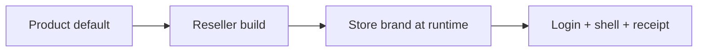
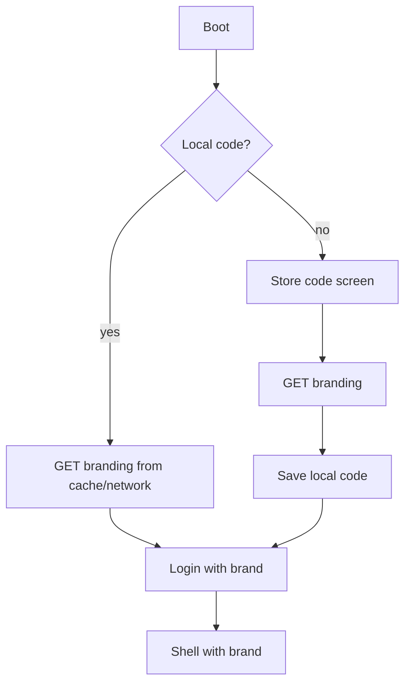

# Store Whitelabel

*Leia em português: [Português](../whitelabel.md).*

**Status:** specification approved for implementation in US-23.
**Scope:** two-level branding (reseller/build + store/runtime), login by code, theme presets, API and offline cache.
**Related:** [UI/UX and Design System](ui-ux.md) — principles, components and screens.
**Out of scope for now:** fully free theme, custom fonts, visual layout editor and dark mode.

This document is normative. **MUST**, **MUST NOT** and **MAY** indicate a requirement, a prohibition and an option.

---

## 1. Two-level model

The product is whitelabel at two independent layers:

1. **Reseller/build (SaaS vendor):** defines the default binary/installer identity — app name, identifier, icon, default logo, default preset, support contact and author credit.
2. **Store/runtime:** the retailer (admin) customizes its own brand inside the app — display name, logo, preset and accent color — without a developer, rebuild or reinstall.

**Precedence:**



`store (runtime) > reseller (build) > product default`

| Item | Reseller (build) | Store (runtime) |
|---|---|---|
| App/installer name | yes | no |
| Tauri identifier | yes | no |
| Executable icon | yes | no |
| Default logo | yes | yes (overrides) |
| Display name | yes (default) | yes (overrides) |
| Theme preset | yes (default) | yes (overrides) |
| Accent color | yes (default) | yes (overrides) |
| Author credit | yes (show/hide) | no |
| Legal/fiscal texts | yes | no |
| API address | yes | no |

The store MUST NOT be able to remove legal notices, reseller credits (when configured) or change layout/fonts.

---

## 2. What the store customizes

**Curated** personalization: ready-made presets + accent. This avoids unreadable combinations and keeps CSP simple (no inline CSS).

### 2.1 Fields

| Field | Rule |
|---|---|
| Display name | 2–80 characters, plain text, no HTML; default = store name |
| Logo | PNG/WebP, transparent or light background, 128–1024 px, ≤ 512 KB; no SVG |
| Preset | one of the official presets |
| Accent | one of the curated colors; defines `primary/hover/soft` |
| Restore default | returns to the build/product preset, accent and logo |

### 2.2 Official presets

| Preset | Suggested use | Surfaces | Text | Default accent |
|---|---|---|---|---|
| Varejo Azul | generic default | page `#f1f5f9`, card `#ffffff`, muted `#e2e8f0` | strong `#0f172a`, body `#334155` | indigo |
| Mercado Verde | markets/produce | page `#f0fdf4`, card `#ffffff`, muted `#dcfce7` | strong `#052e16`, body `#166534` | emerald |
| Conveniência Âmbar | convenience/bakery | page `#fffbeb`, card `#ffffff`, muted `#fef3c7` | strong `#451a03`, body `#78350f` | amber |
| Neutro Grafite | office/back office | page `#f8fafc`, card `#ffffff`, muted `#e2e8f0` | strong `#0f172a`, body `#334155` | slate |
| Café Terracota | cafés/physical stores | page `#fdf6f0`, card `#ffffff`, muted `#f5e6dc` | strong `#2b160e`, body `#5c3a2e` | terracotta |

### 2.3 Curated accents

Each accent has a fixed `primary/hover/soft` triple, pre-validated for AA with white text:

| Accent | primary | hover | soft |
|---|---|---|---|
| indigo | `#4338ca` | `#3730a3` | `#eef2ff` |
| emerald | `#047857` | `#065f46` | `#ecfdf5` |
| amber | `#b45309` | `#92400e` | `#fffbeb` |
| slate | `#334155` | `#1e293b` | `#f1f5f9` |
| terracotta | `#9a3412` | `#7c2d12` | `#fff7ed` |
| blue | `#1d4ed8` | `#1e40af` | `#eff6ff` |
| rose | `#be123c` | `#9f1239` | `#fff1f2` |
| teal | `#0f766e` | `#115e59` | `#f0fdfa` |

The values live in `desktop-client/src/styles/presets.css`; the store chooses names, never hex.

### 2.4 Runtime theme without violating CSP

- The app sets `data-theme="mercado-verde"` and `data-accent="emerald"` on `<html>`; CSS resolves the tokens.
- **Forbidden:** `style={{ ... }}` or `element.style.setProperty` for brand colors; CSP does not allow inline styles.
- Presets/accents are closed enums; the backend rejects values outside the list (422).
- Contrast is validated when building/testing presets; if a preset/accent fails, the app uses the default.
- No theme flash: brand is loaded before rendering login/shell.

---

## 3. Data and API

### 3.1 Data model

`store_settings` gains the public store code; branding lives in its own table (optional binary and audit):

```sql
ALTER TABLE store_settings ADD COLUMN store_code VARCHAR(12) UNIQUE
    CHECK (store_code ~ '^[A-HJ-NP-Z2-9]{8}$');

CREATE TABLE store_branding (
    store_id UUID PRIMARY KEY REFERENCES store_settings(id) ON DELETE CASCADE,
    display_name VARCHAR(80) NOT NULL,
    logo_mime VARCHAR(32),
    logo_bytes BYTEA,
    logo_sha256 BYTEA,
    theme_preset VARCHAR(24) NOT NULL DEFAULT 'varejo-azul',
    accent VARCHAR(24) NOT NULL DEFAULT 'indigo',
    updated_by UUID REFERENCES "user"(id) ON DELETE SET NULL,
    created_at TIMESTAMPTZ NOT NULL DEFAULT now(),
    updated_at TIMESTAMPTZ NOT NULL DEFAULT now(),
    CHECK (octet_length(logo_bytes) <= 524288),
    CHECK (theme_preset IN ('varejo-azul','mercado-verde','conveniencia-ambar','neutro-grafite','cafe-terracota')),
    CHECK (accent IN ('indigo','emerald','amber','slate','terracotta','blue','rose','teal'))
);
```

- Additive migration; `store_code` is filled for existing stores and later becomes `NOT NULL`.
- `store_code` is not a secret: 8 characters from `ABCDEFGHJKLMNPQRSTUVWXYZ23456789` (no `0/O/1/I`), stored uppercase and unique; lookup normalizes input and is case-insensitive.
- Logo is not a secret (public brand); it does not need encryption, but MUST be re-encoded to strip metadata.
- `updated_by` + `AUDIT_LOG` record `branding.updated` and `branding.logo_updated` (no bytes/passwords).
- Every query filters `store_id`; public endpoints only by `store_code`.

### 3.2 Endpoints

| Method | Route | Auth | Purpose |
|---|---|---|---|
| GET | `/api/v1/public/stores/{store_code}/branding` | public | brand for login/first use |
| GET | `/api/v1/public/stores/{store_code}/logo` | public | logo with ETag/Cache-Control |
| GET | `/api/v1/store/branding` | admin | current store brand |
| PUT | `/api/v1/store/branding` | admin | name, preset, accent |
| POST | `/api/v1/store/branding/logo` | admin | base64 upload (`logo_base64`, `logo_mime`) |
| DELETE | `/api/v1/store/branding/logo` | admin | remove logo (back to fallback) |

**Public example:**

```json
{
  "store_code": "PDV23456",
  "display_name": "Mercado Bom Preço",
  "logo_url": "/api/v1/public/stores/PDV23456/logo",
  "theme_preset": "mercado-verde",
  "accent": "emerald",
  "version": 3
}
```

- Public response MUST NOT contain CNPJ, address, user emails or any PII.
- `version`/`ETag` enable caching and invalidation.
- Rate limit: 30 req/min/IP; unknown code → generic 404; no enumeration.
- Mutation errors: 400/401/403/404/413/422/429, domain messages in pt-BR (Swagger in English).
- Upload: 1 MiB body limit; decoded base64 ≤ 512 KB; MIME `image/png`/`image/webp`; server-side re-encode.
- OpenAPI MUST document schemas, examples and all errors (anti-drift test).

---

## 4. Login and store discovery

The operator MUST NOT type a UUID.

1. **Preconfigured:** build/installer provides `default_store_code` (or `VITE_STORE_CODE`). The app fetches the public brand and shows a personalized login.
2. **First use without a code:** “Store code” screen (8 characters) with help; on validation, fetch the brand, persist locally and continue to login.
3. **Local persistence:** Tauri command writes `store.json` in the app data directory (no `localStorage`/`sessionStorage`), with restrictive permissions. The code is not a secret.
4. **Switch store:** clears local code, session, cart and checkout; returns to first use.
5. **Offline:** uses cached brand; login requires a connection and shows a clear notice.



- The public endpoint is called before authentication; therefore it cannot expose sensitive data.
- Cached brand MUST be used if the network fails; if there is no cache, use the build default.

---

## 5. Reseller build (build-time)

The reseller generates a binary/installer with its own identity. In this phase the process is manual and documented; automation arrives in US-23.4.

**Build brand file (`branding.json`, not secret):**

```json
{
  "app_name": "PDV Acme",
  "app_identifier": "com.acme.pdv",
  "logo": "assets/acme-logo.png",
  "theme_preset": "varejo-azul",
  "accent": "indigo",
  "support_email": "suporte@acme.com.br",
  "show_credit": false,
  "default_store_code": null,
  "api_url": "https://api.acme.com.br"
}
```

- `productName`, `identifier`, window title and icons in `tauri.conf.json` derive from this file.
- `VITE_API_URL` remains build-time; the reseller sets the API at build.
- **Vault:** the keyring service/entry MUST include the `app_identifier` (e.g., `com.acme.pdv/session`) so two whitelabel builds do not share a session on the same machine.
- Author credit: `show_credit` controls the login footer; the store cannot change it.
- Icons: proper `.png` (Linux), `.ico` (Windows) and `.icns` (macOS); the current placeholder is not production-ready.
- Installer: reseller name, icon, manufacturer and support URL.
- Updates/telemetry: out of scope; do not add without an explicit decision.

**Future `scripts/build-brand.sh`:** validates `branding.json`, generates `tauri.conf.json`/icons, runs the build and packages. Until then, the manual checklist stays in this document.

---

## 6. Assets, CSP and offline

- Logo is served by the API (`/logo`) or cached as a blob; CSP MUST allow the API origin in `img-src` (e.g., `'self' blob: http://localhost:* https://*.onrender.com`).
- No remote fonts, icon CDN or external scripts.
- `style-src 'self'`: presets via class/data-attribute; no inline styles.
- Logo/brand cached in a local file with `version`/ETag; invalidated when the brand changes.
- No logo: textual fallback (initials/name) with AA contrast.
- Receipt/printing (US12): uses brand logo/name + store fiscal data; not separately editable in this phase.

---

## 7. Security and LGPD

- Brand is public by definition; nevertheless, the public endpoint only returns display name, logo, preset, accent and version.
- Mutations require `admin`; every change writes `AUDIT_LOG` with actor and changed fields (no bytes).
- Upload: no SVG (XSS), real MIME validation, re-encode, size/dimension limits, filename ignored.
- Rate limit on the public endpoint and mutations; generic 404 for unknown code.
- No secrets/tokens/PII in logs or responses.
- `store_code` grants no access: it is only brand discovery; authentication remains mandatory.

---

## 8. Rollout and migration

1. Additive migration + `store_code` backfill; existing stores get the default preset and textual fallback.
2. “Store brand” screen in Settings (admin) with preview and “Restore default”.
3. First-use onboarding by code; documentation for the retailer.
4. Reseller build documented and tested with an example `branding.json`.
5. Tests: API (tenant/validation/rate limit/audit), frontend (preview/fallback/offline) and visual (presets).
6. Update `RESKIN.md`, README and PT/EN docs; remove the instruction for stores to edit CSS.

---

## 9. Acceptance criteria

- An admin changes logo, name, preset and accent in **under 5 minutes**, without a developer, with preview.
- The brand appears on login, shell and receipt (when US12 exists), with AA contrast.
- A store without logo/name uses a legible fallback; an invalid preset falls back to default.
- Preconfigured login does not ask for a UUID; first use accepts a short code and remembers it locally.
- Cached brand works offline; offline login shows a clear notice.
- Mutations are admin-only, audited and isolated by `store_id`; the public endpoint leaks no PII.
- Reseller build changes name/icon/identifier and does not share a session with another build.
- No inline styles, hex outside tokens or external font/CDN dependency.
- PT/EN docs in sync and `./scripts/check-all.sh` green.

---

## 10. Roadmap (US-23)

| Task | Deliverable |
|---|---|
| 23.1 | Backend: `store_code`, `store_branding`, public/admin endpoints, logo, audit, rate limit and tests |
| 23.2 | Login: preconfiguration, first-use code, Tauri persistence, cache/offline and store switch |
| 23.3 | Settings: “Store brand” tab, preview, presets/accents, restore default |
| 23.4 | Reseller build: `branding.json`, icons, `tauri.conf`, keyring namespace, CSP and checklist |
| 23.5 | Receipt/printing (US12) + rollout, PT/EN docs and final tests |

**Dependencies:** US-22 (design system/shell) for the UI; US10 for receipt fiscal data; US12 for printing.

---

## 11. Risks and open decisions

| Risk | Mitigation |
|---|---|
| Free theme breaking contrast | Curated presets/accents + AA validation |
| CSP blocking logo/theme | `img-src` for the API; classes instead of inline styles |
| Enumerable store code | Rate limit, generic 404, no PII |
| Malicious/oversized logo | No SVG, re-encode, limits and audit |
| Two builds on the same PC | Keyring namespace by `app_identifier` |
| Stale brand cache | `version`/ETag + invalidation on save |
| Precedence confusion | UI preview + “reseller default” vs “store brand” labels |

**Future decisions:** fully free accent (would require server-generated CSS + CSP), dark mode, i18n and per-branch brand (multi-store).
