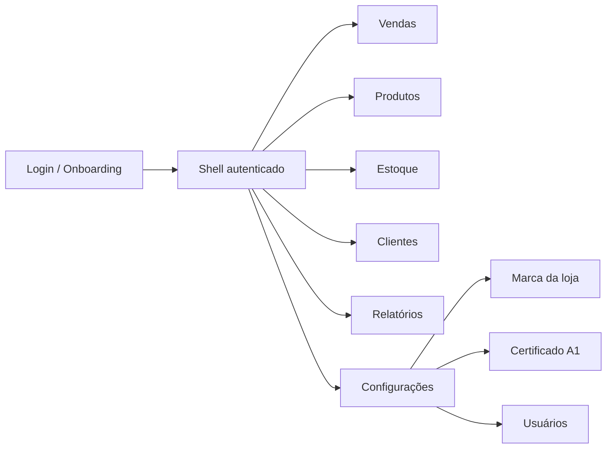

# UI/UX e Design System do PDV

*Read in English: [English](en/ui-ux.md).*

**Status:** especificação aprovada para implementação na US-22 (fundação) e US-23 (whitelabel).
**Escopo:** `desktop-client` (React + TypeScript + Tauri), tema claro, pt-BR, janela mínima 1024×600.
**Fora de escopo agora:** dark mode, i18n, tema totalmente livre, aplicativo mobile e arquivos Figma.
**Documento irmão:** [Whitelabel da loja](whitelabel.md) — modelo de marca, dados, API e build do reseller.

Este documento é normativo. Os verbos **DEVE**, **NÃO DEVE** e **PODE** indicam requisito obrigatório, proibição e opção.

---

## 1. Objetivo

Transformar a interface atual, funcional porém crua e desalinhada, em um PDV preciso para balcão:

- rápido para o operador de caixa (teclado + leitor + toque quando fizer sentido);
- legível em monitor pequeno (1024×600) e em ambiente claro;
- consistente entre telas, estados e papéis;
- acessível (WCAG 2.2 AA) e previsível;
- whitelabel de verdade: a loja troca logo, nome, preset e destaque **sem desenvolvedor**.

O redesign não é cosmético. Ele corrige fluxo de caixa, estados de sessão, foco, leitor de código de barras e a base de componentes antes de novas telas.

---

## 2. Contexto e usuários

| Persona | Objetivo principal | Restrições |
|---|---|---|
| Operador de caixa | Bipar, buscar, fechar venda e dar troco com o mínimo de cliques | Pressa, fila, teclado, leitor, pouca tolerância a erro |
| Gerente | Cadastrar/editar produtos, ajustar estoque, autorizar exceções (US21) | Precisa de visão gerencial sem sair do fluxo |
| Dono/administrador | Configurar loja, marca, certificado, usuários e auditoria | Acesso raro, precisa de clareza e segurança |
| Reseller/operador SaaS | Gerar build com a própria marca e oferecer suporte | Não pode editar código por loja |

**Ambiente de uso:** balcão iluminado, monitor de 1024×600 a 1440×900, hardware legado (baixo RAM), teclado físico, leitor tipo teclado (wedge), toque opcional, internet instável.

**Metas mensuráveis:**

- venda de 5 itens concluída em menos de 30 s por operador treinado;
- nenhuma ação destrutiva sem confirmação ou desfazer;
- contraste AA em todo texto e componente interativo;
- app operável só com teclado;
- consumo de memória dentro da meta da US05 (≤ 80 MB em repouso).

---

## 3. Diagnóstico atual

| Área | Estado hoje | Impacto | Prioridade |
|---|---|---|---|
| Login | UUID da loja digitado, sem `<form>`, autofocus ou erro por campo | Erro de digitação e barreira de entrada | P0 |
| Shell | Sem marca, nome da loja, item ativo, título de página ou `aria-current` | Orientação fraca; cara de protótipo | P0 |
| Vendas | Sem busca manual, quantidade editável, desconto, atalhos; totais no fluxo; scanner ativo no pagamento | Lentidão e risco de venda errada | P0 |
| Pagamento | `role="dialog"` sem overlay, foco preso, ESC ou bloqueio do fundo | Foco escapa; bip altera o carrinho durante o pagamento | P0 |
| Produtos | Apenas criação; sem lista, edição, desativação ou estoque | Retaguarda incompleta | P1 |
| Configurações/Relatórios | Placeholders | Sem marca, certificado ou gestão | P1 |
| Design system | CSS global mínimo; só `.card`, `.primary` e `.change-highlight`; sem layout, tabela, modal ou breakpoints | Cada tela inventa estrutura | P0 (fundação) |
| Whitelabel | Só troca de tokens em `tokens.css`; nome, logo, título, ícone e rodapé hardcoded | Loja não consegue se apropriar do produto | P0 (lançamento) |
| Sessão/estado | Logout não limpa carrinho/checkout/tela; 401 não derruba a UI | Vazamento de dados entre operadores | P0 (segurança) |
| Testes | 74 testes dependem dos textos/labels atuais; sem a11y ou regressão visual | Redesign quebra sem rede de proteção | P1 |

Conclusão: a fundação (design system + shell + estados) vem antes de telas novas. A tela de certificado da US10 DEVE nascer já no novo padrão.

---

## 4. Princípios de design

1. **Clareza antes de densidade.** Informação essencial visível; o resto em hierarquia.
2. **Densidade controlada.** Cabe mais sem apertar: tabelas compactas, respiro de 8/16 px.
3. **Teclado-first.** Toda ação frequente tem atalho; foco sempre visível.
4. **Feedback imediato.** Bip, adição, remoção, pagamento e erro têm resposta visual e sonora/aria.
5. **Prevenção de erro.** Confirmação para destruição; desfazer para remoção; validação junto ao campo.
6. **Consistência.** Um componente, um comportamento; variantes explícitas.
7. **Acessibilidade AA.** Contraste, rótulos, foco, leitor de tela e alvos de 44 px.
8. **Offline-first.** Nenhuma dependência de fonte ou ícone remoto; estados offline explícitos.
9. **Whitelabel sem código.** Marca da loja por configuração, com limites que preservam legibilidade.
10. **Performance.** Sem bibliotecas pesadas, fontes web ou renderização desnecessária.

---

## 5. Arquitetura de informação



| Tela | Papéis | Estado atual | Meta |
|---|---|---|---|
| Login/Onboarding | público | funcional | marca + loja pré-configurada + código |
| Vendas | caixa, gerente, admin | funcional | busca, scanner, carrinho, atalhos, totais fixos |
| Produtos | gerente, admin | criação | lista, busca, criar/editar, desativar |
| Estoque | gerente, admin | sem UI | saldo + ajuste com motivo |
| Clientes | gerente, admin (futuro caixa) | sem UI | busca, PF/PJ, CPF na nota |
| Relatórios | gerente, admin | placeholder | US17 |
| Configurações | admin | placeholder | marca, certificado, usuários, fiscal |

**Navegação:** estado tipado (`Screen`) nesta fase; sem router até existir necessidade real de deep link. O item ativo DEVE ter `aria-current="page"`. Logout DEVE voltar para o login e limpar `screen`, carrinho e checkout.

---

## 6. Layout e shell

**Janela:** 1024×600 mínimo; 1280×800 padrão; conteúdo máximo de 1440 px.

**Shell:**

```text
┌──────────────────────────────────────────────────────────────┐
│ [Logo] Nome da loja     Vendas  Produtos  Estoque  ...       │
│                                          Operador (papel) ▾  │
├──────────────────────────────────────────────────────────────┤
│ Título da página + ação principal                            │
│                                                              │
│ Conteúdo                                                     │
└──────────────────────────────────────────────────────────────┘
```

- Top bar de 56 px, borda inferior, fundo `surface-card`.
- Marca à esquerda (logo + nome); navegação ao lado; usuário/menu à direita.
- Conteúdo com padding de 16 px (compacto) ou 24 px (≥1280).
- Título de página (`PageHeader`) com ação primária à direita.
- Sem sidebar nesta fase: o PDV precisa de largura para o carrinho.

**Vendas em 1024×600:** duas colunas (busca/catálogo ~38%, carrinho ~62%), gap de 16 px. Totais e botão de pagamento fixos no rodapé da coluna do carrinho.

```text
┌──────────────────────────────┬───────────────────────────────┐
│ Buscar / bipar [__________]  │ Carrinho (3 itens)            │
│ Resultados                   │ Item  Qtd  Unit  Desc  Total  │
│ ┌──────────────────────────┐ │ Arroz   2   27,99  —   55,98  │
│ │ Arroz T1 5kg     R$27,99 │ │ Café    1   18,99  —   18,99  │
│ └──────────────────────────┘ │ Leite   1    5,99  —    5,99  │
│                              ├───────────────────────────────┤
│                              │ Subtotal           R$ 80,96   │
│                              │ Total              R$ 80,96   │
│                              │ [F4 Pagamento]  [Limpar]      │
└──────────────────────────────┴───────────────────────────────┘
```

**Breakpoints:** `sm 640`, `md 768`, `lg 1024`, `xl 1280`, `2xl 1440`. Abaixo de 1024 não é suportado (limite da janela).

---

## 7. Design system

### 7.1 Tokens

`desktop-client/src/styles/tokens.css` continua sendo a **fonte da verdade** das cores, tipografia, espaçamento, raios e alvos. Nenhum hex/rgb/hsl fora dele. Presets de whitelabel ficam em `presets.css` e apenas trocam valores semânticos.

| Grupo | Tokens |
|---|---|
| Superfícies | `--surface-page`, `--surface-card`, `--surface-overlay`, `--surface-muted` |
| Texto | `--text-strong`, `--text-body`, `--text-muted`, `--text-on-primary` |
| Ação | `--primary`, `--primary-hover`, `--primary-soft`, `--focus-ring` |
| Estados | `--danger`, `--danger-soft`, `--success`, `--success-soft`, `--warning`, `--warning-soft` |
| Forma | `--radius-sm/md/lg`, `--space-1…6`, `--tap-min` |
| Tipografia | `--font-sans`, `--font-mono`, `--text-sm/md/lg/xl` |

**Tema:** somente claro nesta fase. Os tokens DEVEM ser organizados para permitir dark mode futuro sem reescrever componentes.

### 7.2 Tailwind v4

Adoção planejada na US-22, sem quebrar o whitelabel:

- `tailwindcss` + `@tailwindcss/vite` (MIT), CSS-first, sem `tailwind.config.js`.
- `tokens.css` permanece a fonte; `theme.css` mapeia tokens para o Tailwind:

```css
@import "tailwindcss";

@theme inline {
  --color-surface-page: var(--surface-page);
  --color-surface-card: var(--surface-card);
  --color-text-strong: var(--text-strong);
  --color-primary: var(--primary);
  --radius-card: var(--radius-md);
}
```

- Utilidades semânticas: `bg-surface-card`, `text-strong`, `rounded-card`, `p-4`.
- Proibido valor arbitrário de cor (`bg-[#...]`, `text-[rgb(...)]`).
- Valores arbitrários de layout só com justificativa em review.
- Variantes de componente com `class-variance-authority` (Apache-2.0), `clsx` e `tailwind-merge` (MIT).
- Primitivos acessíveis com Radix UI (MIT): Dialog, Tabs, Select, Toast, Tooltip, Dropdown.
- Ícones com Lucide React (ISC), traço 1.5–2, tamanhos 16/20/24.
- Fontes do sistema; nenhuma webfont remota (offline/CSP).

### 7.3 Tipografia e números

| Uso | Tamanho / peso |
|---|---|
| Título de página | 24 px / 600 |
| Título de seção | 20 px / 600 |
| Corpo | 16 px / 400 |
| Secundário | 14 px / 400 |
| Rótulo | 14 px / 500 |
| Micro (atalho, badge) | 12 px / 500 |

- Dinheiro e quantidade usam `font-variant-numeric: tabular-nums`, alinhados à direita.
- BRL sempre com 2 casas; quantidade com até 3 casas (regra do domínio).
- Nunca abreviar valores no carrinho/totais.

### 7.4 Espaçamento, forma e movimento

- Escala de 4 px; componentes usam 8/12/16/24.
- Raios: 6 px (controle), 10 px (card), 16 px (modal/overlay).
- Alvo mínimo de toque: 44×44 px; em tabela densa, 36 px é aceitável apenas com teclado.
- Sombras discretas: `sm` para card, `md` para dropdown, `lg` para modal.
- `z-index`: conteúdo 0, sticky 10, dropdown 20, overlay 30, modal 40, toast 50.
- Transições de 120–180 ms; respeitar `prefers-reduced-motion`.

### 7.5 Componentes

| Componente | Variantes / estados | Regras |
|---|---|---|
| Button | primary, secondary, ghost, danger; sm/md/lg; loading, disabled | Ícone opcional; icon-only exige `aria-label`; loading bloqueia duplo clique |
| IconButton | ghost, danger | 44×44; tooltip com atalho |
| Input / Field | default, focus, error, disabled, readonly | Label sempre visível; erro com `aria-invalid` + `aria-describedby`; hint opcional |
| Select | default, error | Radix Select; teclado completo |
| Dialog | sm/md/lg; confirm destrutivo | Overlay, foco preso, ESC, retorno de foco, scroll lock |
| Toast | success, error, info; com ação | `aria-live`; 4 s; ação “Desfazer” quando aplicável |
| Table | default, compact, loading, empty | Cabeçalho fixo; números à direita; ações na linha; virtualizar >50 linhas |
| Tabs | default | Radix; aba ativa visível; setas do teclado |
| Badge | neutral, success, warning, danger | Texto curto; não depender só de cor |
| EmptyState | com/sem ação | Ícone, título, descrição, CTA |
| Skeleton | texto, tabela, card | Sem animação agressiva |
| Kbd | tecla isolada, combinação | Usado em atalhos e dicas |
| PageHeader | título, subtítulo, ação | Sempre presente em telas autenticadas |
| Brand | logo completo, marca, fallback textual | Ver [whitelabel](whitelabel.md) |
| StatCard | valor, rótulo, variação | Relatórios/dashboard |

**Estados obrigatórios por tela:** carregando, vazio, erro, sucesso, sem permissão e offline (quando aplicável).

---

## 8. Especificação das telas

### 8.1 Login e onboarding

**Objetivo:** entrar com o mínimo de fricção, com a marca da loja visível antes da autenticação.

- Loja pré-configurada no instalador OU código curto no primeiro uso (ver [whitelabel](whitelabel.md)).
- Campos: email, senha (com “mostrar”), sem UUID quando a loja já é conhecida.
- `<form>` real; Enter envia de qualquer campo; autofocus no email.
- Erro por campo + erro geral em `role="alert"`; mensagem genérica para credencial inválida.
- “Trocar loja” limpa a loja local e a sessão.
- Rodapé de crédito do reseller é opcional (build), não da loja.
- Estado offline: mostra a marca em cache e avisa que o login precisa de conexão.

```text
┌────────────────────────────────────────────┐
│                [Logo da loja]              │
│                Mercado Bom Preço           │
│  Email  [________________________________] │
│  Senha  [________________________] [ver]   │
│  [ Entrar ]                                │
│  Trocar loja · Ajuda                       │
│  crédito do reseller (opcional)            │
└────────────────────────────────────────────┘
```

**Aceite:** login só com teclado; erros associados aos campos; marca carregada antes do formulário; nenhum UUID visível no fluxo pré-configurado.

### 8.2 Shell

- Top bar com marca, navegação, usuário e papel legível (“Gerente”, não `manager`).
- Item ativo com `aria-current` e indicador visual.
- Logout com confirmação se houver venda em andamento; limpa sessão, carrinho, checkout e tela.
- Sem telas vazias após troca de papel: se a tela atual não for permitida, voltar para Vendas.

### 8.3 Vendas

**Objetivo:** bipar ou buscar, ajustar o carrinho e fechar a venda sem sair do teclado.

- Busca por nome/SKU/código com debounce de 250 ms e mínimo de 2 caracteres.
- Modo bip x modo busca: foco na busca desliga a captura global; ESC volta ao modo bip.
- Leitor aceita alfanumérico (Code 128/EAN) e mínimo de 4 caracteres; bips são enfileirados.
- Item repetido soma quantidade; quantidade editável com stepper; desconto por item/valor conforme regra (US21 para desconto alto).
- Remover item com “Desfazer” em toast; limpar carrinho com confirmação.
- Totais e “Pagamento” fixos no rodapé da coluna; “Finalizar venda” não exige tabular por todos os itens.
- Indicador “Bip pronto” e anúncio `aria-live` ao adicionar item/total.
- Estados: vazio (“Bipe ou busque um produto”), carregando, produto não encontrado, estoque insuficiente, erro de rede.

**Aceite:** venda completa sem mouse; scanner não adiciona item com modal aberto; totais sempre visíveis; remoção reversível.

### 8.4 Pagamento

**Objetivo:** receber valores fracionados, calcular troco e concluir com segurança.

- Dialog real (Radix) com overlay, foco preso, ESC e retorno de foco.
- Resumo: total, pago, falta; valores em BRL tabular.
- Métodos: dinheiro, PIX, crédito, débito; dinheiro exige valor recebido; troco em destaque.
- “Adicionar pagamento” por Enter; lista com remoção; “Finalizar” só com falta = 0.
- Cancelar com pagamentos exige confirmação; scanner desligado enquanto o dialog estiver aberto.
- Estados: processando, erro, sucesso com comprovante (impressão na US12).

```text
┌──────────────────────────────────────────────┐
│ Fechamento de venda                      [x] │
│ Total R$ 80,96 · Pago R$ 0,00 · Falta 80,96  │
│ [Dinheiro] [PIX] [Crédito] [Débito]          │
│ Valor recebido [R$ 100,00]                   │
│ [Adicionar pagamento]                        │
│ Pagamentos: Dinheiro R$ 100,00 [remover]     │
│ Troco R$ 19,04                               │
│ [Cancelar]                     [Finalizar]   │
└──────────────────────────────────────────────┘
```

**Aceite:** foco nunca sai do dialog; ESC cancela com confirmação; troco correto; sem duplo envio.

### 8.5 Produtos e estoque

- Lista com busca, paginação e status ativo/inativo; ação “Novo produto”.
- Formulário em página ou drawer com abas “Dados gerais” e “Fiscal”; aba ativa visível.
- Validação junto ao campo; NCM 8 dígitos; alíquota 0–100; origem ICMS em select.
- Sucesso com toast e retorno à lista; edição e desativação com confirmação.
- Ajuste de estoque em dialog com motivo obrigatório, lote atômico e feedback de saldo.
- Estados: vazio, carregando, erro, sem permissão (caixa).

### 8.6 Configurações

Abas: **Marca da loja**, **Certificado A1**, **Usuários**, **Fiscal**. Apenas admin.

- Marca: logo, nome de exibição, preset, destaque, preview e “Restaurar padrão” (US-23).
- Certificado: upload `.pfx/.p12`, senha, validade e status; nunca exibe senha (US10).
- Usuários: lista, criação, papel e desativação (US02 já no backend).
- Fiscal: dados da loja/emitente (US10) e integrações.

### 8.7 Relatórios

Placeholder até a US17, mas já com `PageHeader`, estado vazio e skeleton — sem tela em branco.

### 8.8 Sessão expirada e offline

- 401: limpar token, usuário, carrinho, checkout e tela; voltar ao login com aviso “Sessão expirada”.
- Expiração próxima: aviso não bloqueante (quando houver refresh/timer).
- Offline: banner persistente; operações que exigem API mostram erro claro e ação “Tentar de novo”.

---

## 9. Padrões de interação

### 9.1 Leitor de código de barras

- Captura global apenas em Vendas e sem dialog aberto.
- Entrada termina em Enter; aceitar letras e números; mínimo 4 caracteres.
- Fila sequencial para não resolver bips fora de ordem.
- Feedback visual e sonoro (quando disponível) para sucesso/erro.
- Ao focar a busca, o modo bip pausa; ESC devolve o foco ao modo bip.

### 9.2 Atalhos

| Tecla | Ação |
|---|---|
| F1 | Ajuda/atalhos |
| F2 | Focar busca |
| F3 | Alternar bip/busca |
| F4 | Abrir pagamento |
| F8 | Finalizar venda (quando habilitado) |
| Enter | Confirmar/adicionar |
| ESC | Fechar dialog/cancelar busca |
| Delete | Remover item (com desfazer) |
| `+` / `-` | Ajustar quantidade do item focado |

Atalhos NÃO DEVEM disparar enquanto o foco estiver em campo de texto, salvo F4/F8 quando explicitamente permitido.

### 9.3 Erros, loading e confirmação

- Erro de campo: inline, borda + texto, `aria-invalid` e `aria-describedby`.
- Erro global: toast ou banner, mensagem de domínio da API, sem PII/segredo.
- Loading: skeleton para listas; spinner + `aria-busy` para ações.
- Destrutivo: confirmação; quando possível, “Desfazer” em vez de bloquear.
- Nunca usar `window.alert/confirm`; usar Dialog do design system.

---

## 10. Acessibilidade

- WCAG 2.2 AA: contraste 4,5:1 para texto e 3:1 para componentes/ícones.
- Foco visível em todo elemento interativo; ordem de tabulação lógica.
- Labels explícitos; nunca placeholder como único rótulo.
- `aria-live` para item adicionado, total, troco, erro e sucesso.
- Dialog com foco preso, ESC, retorno de foco e fundo inerte.
- Alvos de 44×44 px; exceções de tabela apenas com teclado.
- Respeitar `prefers-reduced-motion`; sem animações que atrapalhem.
- Testar com leitor de tela (Orca/NVDA) e navegação só por teclado.

---

## 11. Performance e offline

- Meta de memória da US05: ≤ 80 MB em repouso; medir antes/depois de cada fase.
- Sem webfonts, CDN de ícones ou bibliotecas de gráficos pesadas.
- Code splitting por tela; virtualizar listas > 50 linhas.
- Imagens de logo otimizadas e cacheadas; sem re-render desnecessário do carrinho.
- Estados offline explícitos; fila offline completa fica na US13.
- Evitar `console.*`, `any`, `localStorage`/`sessionStorage` (guardas existentes).

---

## 12. Testes e QA

- **Vitest + Testing Library:** comportamento por papel/label, teclado, estados e erros.
- **Acessibilidade:** `jest-axe`/`axe-core` nos componentes críticos; lint `jsx-a11y` na US-22.
- **Visual:** baseline com Playwright (Apache-2.0) para login, vendas, pagamento e produtos; comparar 1024×600 e 1280×800.
- **Manual:** matriz de teclado, scanner simulado, contraste, leitor de tela e hardware legado.
- **DoD de UI:** testes verdes, estados completos, sem hex fora dos tokens, sem storage web, sem `any`, build Vite ok, docs atualizadas.

---

## 13. Roadmap

### US-22 — Fundação UI/UX

| Task | Entrega |
|---|---|
| 22.1 | Tailwind v4 + tokens + primitives + atualização de docs/guards |
| 22.2 | Shell, login/onboarding, sessão/carrinho/401, PageHeader |
| 22.3 | Vendas: busca, scanner, carrinho, quantidade, desconto, totais fixos, atalhos |
| 22.4 | Pagamento: Dialog real, foco/ESC, scanner off, confirmações, toast |
| 22.5 | Produtos/estoque: lista, formulário, validação, ajuste |
| 22.6 | QA: axe, baseline visual, teclado, 1024×600, performance |

### US-23 — Whitelabel

Detalhada em [whitelabel](whitelabel.md): backend de marca, login por código, tela “Marca da loja”, build do reseller, cache/CSP e testes.

**Dependência:** a tela de certificado da US10 DEVE usar os componentes da 22.1/22.2. Se a US10 for executada antes, o componente de upload nasce no padrão novo.

**Portão de lançamento:** US-22 e US-23 concluídas; QA de acessibilidade/visual aprovado; documentação PT/EN sincronizada.

---

## 14. Riscos e decisões abertas

| Risco | Mitigação |
|---|---|
| Migração Tailwind quebrar testes/labels | Fazer na 22.1 com atualização intencional de testes e baseline visual |
| CSP bloquear tema/logo | Presets por classe; logo via API/blob permitido em `img-src`; sem estilo inline |
| Densidade em 1024×600 | Layout de duas colunas validado em protótipo e teste visual |
| Scanner interferir no pagamento | Captura desligada com dialog aberto + teste automatizado |
| Múltiplos builds whitelabel no mesmo PC | Namespace do cofre por identificador do app (US-23) |
| Código da loja enumerável | Rate limit, 404 genérico e nenhum dado sensível no endpoint público |
| Logo malicioso/grande | Sem SVG, re-encode, limite de tamanho/dimensão e auditoria |

**Fora de escopo agora:** dark mode, i18n, tema totalmente livre, editor visual de layout e app mobile. A estrutura de tokens DEVE permitir dark mode futuro sem retrabalho.
