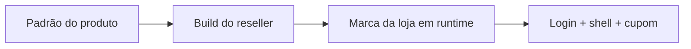
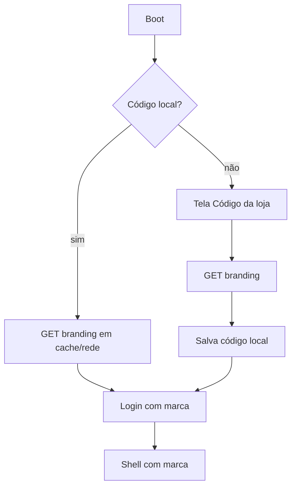

# Whitelabel da Loja

*Read in English: [English](en/whitelabel.md).*

**Status:** especificação aprovada para implementação na US-23.
**Escopo:** marca em dois níveis (reseller/build + loja/runtime), login por código, presets de tema, API e cache offline.
**Relacionado:** [UI/UX e Design System](ui-ux.md) — princípios, componentes e telas.
**Fora de escopo agora:** tema totalmente livre, fontes personalizadas, editor visual de layout e dark mode.

Este documento é normativo. **DEVE**, **NÃO DEVE** e **PODE** indicam requisito, proibição e opção.

---

## 1. Modelo de dois níveis

O produto é whitelabel em duas camadas independentes:

1. **Reseller/build (fornecedor do SaaS):** define a identidade padrão do binário/instalador — nome do app, identificador, ícone, logo padrão, preset padrão, contato de suporte e crédito do autor.
2. **Loja/runtime:** o lojista (admin) personaliza a própria marca dentro do app — nome de exibição, logo, preset e cor de destaque — sem desenvolvedor, sem rebuild e sem reinstalação.

**Precedência:**



`loja (runtime) > reseller (build) > padrão do produto`

| Item | Reseller (build) | Loja (runtime) |
|---|---|---|
| Nome do app/instalador | sim | não |
| Identificador Tauri | sim | não |
| Ícone do executável | sim | não |
| Logo padrão | sim | sim (substitui) |
| Nome de exibição | sim (padrão) | sim (substitui) |
| Preset de tema | sim (padrão) | sim (substitui) |
| Cor de destaque | sim (padrão) | sim (substitui) |
| Crédito do autor | sim (mostrar/ocultar) | não |
| Textos legais/fiscais | sim | não |
| Endereço da API | sim | não |

A loja NÃO DEVE conseguir remover avisos legais, créditos do reseller (quando configurados) ou trocar layout/fontes.

---

## 2. O que a loja personaliza

Personalização **curada**: presets prontos + destaque. Isso evita combinações ilegíveis e mantém a CSP simples (sem CSS inline).

### 2.1 Campos

| Campo | Regra |
|---|---|
| Nome de exibição | 2–80 caracteres, texto simples, sem HTML; padrão = nome da loja |
| Logo | PNG/WebP, fundo transparente ou claro, 128–1024 px, ≤ 512 KB; sem SVG |
| Preset | um dos presets oficiais |
| Destaque | uma das cores curadas; define `primary/hover/soft` |
| Restaurar padrão | volta ao preset/destaque/logo do build ou do produto |

### 2.2 Presets oficiais

| Preset | Uso indicado | Superfícies | Texto | Destaque padrão |
|---|---|---|---|---|
| Varejo Azul | padrão genérico | page `#f1f5f9`, card `#ffffff`, muted `#e2e8f0` | strong `#0f172a`, body `#334155` | indigo |
| Mercado Verde | mercados/hortifruti | page `#f0fdf4`, card `#ffffff`, muted `#dcfce7` | strong `#052e16`, body `#166534` | emerald |
| Conveniência Âmbar | conveniência/padaria | page `#fffbeb`, card `#ffffff`, muted `#fef3c7` | strong `#451a03`, body `#78350f` | amber |
| Neutro Grafite | escritório/retaguarda | page `#f8fafc`, card `#ffffff`, muted `#e2e8f0` | strong `#0f172a`, body `#334155` | slate |
| Café Terracota | cafeterias/lojas físicas | page `#fdf6f0`, card `#ffffff`, muted `#f5e6dc` | strong `#2b160e`, body `#5c3a2e` | terracotta |

### 2.3 Destaques curados

Cada destaque tem um triplo fixo `primary/hover/soft`, pré-validado em AA com texto branco:

| Destaque | primary | hover | soft |
|---|---|---|---|
| indigo | `#4338ca` | `#3730a3` | `#eef2ff` |
| emerald | `#047857` | `#065f46` | `#ecfdf5` |
| amber | `#b45309` | `#92400e` | `#fffbeb` |
| slate | `#334155` | `#1e293b` | `#f1f5f9` |
| terracotta | `#9a3412` | `#7c2d12` | `#fff7ed` |
| blue | `#1d4ed8` | `#1e40af` | `#eff6ff` |
| rose | `#be123c` | `#9f1239` | `#fff1f2` |
| teal | `#0f766e` | `#115e59` | `#f0fdfa` |

Os valores vivem em `desktop-client/src/styles/presets.css`; a loja escolhe nomes, nunca hex.

### 2.4 Tema em runtime sem violar a CSP

- O app aplica `data-theme="mercado-verde"` e `data-accent="emerald"` no `<html>`; o CSS resolve os tokens.
- **Proibido** `style={{ ... }}` ou `element.style.setProperty` para cores de marca; a CSP não permite estilo inline.
- Presets/destaques são enums fechados; o backend rejeita valores fora da lista (422).
- Contraste é validado no build/teste dos presets; se um preset/destaque falhar, o app usa o padrão.
- Sem “flash” de tema: a marca é carregada antes de renderizar login/shell.

---

## 3. Dados e API

### 3.1 Modelo de dados

`store_settings` ganha o código público da loja; a marca fica em tabela própria (binário opcional e auditoria):

```sql
ALTER TABLE store_settings ADD COLUMN store_code VARCHAR(12) UNIQUE
    CHECK (store_code ~ '^[A-HJ-NP-Z2-9]{8}$');

CREATE TABLE store_branding (
    store_id UUID PRIMARY KEY REFERENCES store_settings(id) ON DELETE CASCADE,
    display_name VARCHAR(80) NOT NULL,
    logo_mime VARCHAR(32),
    logo_bytes BYTEA,
    logo_sha256 BYTEA,
    theme_preset VARCHAR(24) NOT NULL DEFAULT 'varejo-azul',
    accent VARCHAR(24) NOT NULL DEFAULT 'indigo',
    updated_by UUID REFERENCES "user"(id) ON DELETE SET NULL,
    created_at TIMESTAMPTZ NOT NULL DEFAULT now(),
    updated_at TIMESTAMPTZ NOT NULL DEFAULT now(),
    CHECK (octet_length(logo_bytes) <= 524288),
    CHECK (theme_preset IN ('varejo-azul','mercado-verde','conveniencia-ambar','neutro-grafite','cafe-terracota')),
    CHECK (accent IN ('indigo','emerald','amber','slate','terracotta','blue','rose','teal'))
);
```

- Migração aditiva; `store_code` é preenchido para lojas existentes e depois vira `NOT NULL`.
- `store_code` não é segredo: 8 caracteres de `ABCDEFGHJKLMNPQRSTUVWXYZ23456789` (sem `0/O/1/I`), armazenado em maiúsculas e único; a busca normaliza a entrada e não diferencia caixa.
- Logo não é segredo (marca pública); não precisa de criptografia, mas DEVE ser re-encodado para remover metadados.
- `updated_by` + `AUDIT_LOG` registram `branding.updated` e `branding.logo_updated` (sem bytes/senhas).
- Toda query filtra `store_id`; endpoints públicos só por `store_code`.

### 3.2 Endpoints

| Método | Rota | Auth | Uso |
|---|---|---|---|
| GET | `/api/v1/public/stores/{store_code}/branding` | pública | marca para login/primeiro uso |
| GET | `/api/v1/public/stores/{store_code}/logo` | pública | logo com ETag/Cache-Control |
| GET | `/api/v1/store/branding` | admin | marca atual da loja |
| PUT | `/api/v1/store/branding` | admin | nome, preset, destaque |
| POST | `/api/v1/store/branding/logo` | admin | upload base64 (`logo_base64`, `logo_mime`) |
| DELETE | `/api/v1/store/branding/logo` | admin | remove logo (volta ao fallback) |

**Exemplo público:**

```json
{
  "store_code": "PDV23456",
  "display_name": "Mercado Bom Preço",
  "logo_url": "/api/v1/public/stores/PDV23456/logo",
  "theme_preset": "mercado-verde",
  "accent": "emerald",
  "version": 3
}
```

- Resposta pública NÃO DEVE conter CNPJ, endereço, email de usuários ou qualquer PII.
- `version`/`ETag` permitem cache e invalidação.
- Rate limit: 30 req/min/IP; código inexistente → 404 genérico; sem enumeração.
- Erros de mutação: 400/401/403/404/413/422/429, mensagens de domínio em pt-BR (Swagger em inglês).
- Upload: limite de corpo 1 MiB; base64 decodificado ≤ 512 KB; MIME `image/png`/`image/webp`; re-encode no servidor.
- OpenAPI DEVE documentar schemas, exemplos e todos os erros (teste anti-drift).

---

## 4. Login e descoberta da loja

O operador NÃO DEVE digitar UUID.

1. **Pré-configurado:** build/instalador fornece `default_store_code` (ou `VITE_STORE_CODE`). O app busca a marca pública e mostra o login já personalizado.
2. **Primeiro uso sem código:** tela “Código da loja” (8 caracteres) com ajuda; ao validar, busca a marca, persiste localmente e segue para o login.
3. **Persistência local:** comando Tauri grava `store.json` no diretório de dados do app (sem `localStorage`/`sessionStorage`), com permissões restritas. O código não é segredo.
4. **Trocar loja:** limpa código local, sessão, carrinho e checkout; volta ao primeiro uso.
5. **Offline:** usa a marca em cache; login exige conexão e mostra aviso claro.



- O endpoint público é chamado antes da autenticação; por isso não pode expor dados sensíveis.
- A marca em cache DEVE ser usada se a rede falhar; se não houver cache, usar o padrão do build.

---

## 5. Build do reseller (build-time)

O reseller gera um binário/instalador com a própria identidade. Nesta fase, o processo é manual e documentado; a automação entra na US-23.4.

**Arquivo de marca do build (`branding.json`, não secreto):**

```json
{
  "app_name": "PDV Acme",
  "app_identifier": "com.acme.pdv",
  "logo": "assets/acme-logo.png",
  "theme_preset": "varejo-azul",
  "accent": "indigo",
  "support_email": "suporte@acme.com.br",
  "show_credit": false,
  "default_store_code": null,
  "api_url": "https://api.acme.com.br"
}
```

- `productName`, `identifier`, título da janela e ícones em `tauri.conf.json` derivam desse arquivo.
- `VITE_API_URL` continua build-time; o reseller define a API no build.
- **Cofre:** o serviço/entrada do keyring DEVE incluir o `app_identifier` (ex.: `com.acme.pdv/session`) para dois builds whitelabel não compartilharem sessão na mesma máquina.
- Crédito do autor: `show_credit` controla o rodapé do login; a loja não altera.
- Ícones: `.png` (Linux), `.ico` (Windows) e `.icns` (macOS) próprios; o placeholder atual não serve para produção.
- Instalador: nome, ícone, fabricante e URL de suporte do reseller.
- Atualizações/telemetria: fora do escopo; não adicionar sem decisão explícita.

**Fluxo futuro `scripts/build-brand.sh`:** valida `branding.json`, gera `tauri.conf.json`/ícones, roda o build e empacota. Até lá, o checklist manual fica neste documento.

---

## 6. Assets, CSP e offline

- Logo é servido pela API (`/logo`) ou cacheado como blob; CSP DEVE permitir a origem da API em `img-src` (ex.: `'self' blob: http://localhost:* https://*.onrender.com`).
- Nenhuma fonte remota, CDN de ícone ou script externo.
- `style-src 'self'`: presets por classe/data-attribute; sem estilo inline.
- Cache do logo/marca em arquivo local com `version`/ETag; invalidação ao trocar a marca.
- Sem logo: fallback textual (iniciais/nome) com contraste AA.
- Cupom/impressão (US12): usa logo/nome da marca + dados fiscais da loja; não é editável separadamente nesta fase.

---

## 7. Segurança e LGPD

- Marca é pública por definição; ainda assim, o endpoint público só devolve nome de exibição, logo, preset, destaque e versão.
- Mutações exigem `admin`; toda alteração gera `AUDIT_LOG` com ator e campos alterados (sem bytes).
- Upload: sem SVG (XSS), validação de MIME real, re-encode, limite de tamanho/dimensão, nome de arquivo ignorado.
- Rate limit no endpoint público e nas mutações; 404 genérico para código inexistente.
- Nenhum segredo/token/PII em logs ou respostas.
- `store_code` não concede acesso: é apenas descoberta de marca; autenticação continua obrigatória.

---

## 8. Rollout e migração

1. Migração aditiva + backfill de `store_code`; lojas existentes recebem preset padrão e fallback textual.
2. Tela “Marca da loja” em Configurações (admin) com preview e “Restaurar padrão”.
3. Onboarding do primeiro uso por código; documentação para o lojista.
4. Build do reseller documentado e testado com um `branding.json` de exemplo.
5. Testes: API (tenant/validação/rate limit/auditoria), frontend (preview/fallback/offline) e visual (presets).
6. Atualizar `RESKIN.md`, README e docs PT/EN; remover a instrução de editar CSS para a loja.

---

## 9. Critérios de aceite

- Um admin troca logo, nome, preset e destaque em **menos de 5 minutos**, sem desenvolvedor, com preview.
- A marca aparece no login, no shell e no cupom (quando US12 existir), com contraste AA.
- Loja sem logo/nome usa fallback legível; preset inválido cai no padrão.
- Login pré-configurado não pede UUID; primeiro uso aceita código curto e lembra localmente.
- Marca em cache funciona offline; login offline mostra aviso claro.
- Mutações são admin-only, auditadas e isoladas por `store_id`; endpoint público não vaza PII.
- Build do reseller troca nome/ícone/identificador e não compartilha sessão com outro build.
- Nenhum estilo inline, hex fora dos tokens ou dependência de fonte/CDN externa.
- Docs PT/EN sincronizadas e `./scripts/check-all.sh` verde.

---

## 10. Roadmap (US-23)

| Task | Entrega |
|---|---|
| 23.1 | Backend: `store_code`, `store_branding`, endpoints público/admin, logo, auditoria, rate limit e testes |
| 23.2 | Login: pré-configuração, código no primeiro uso, persistência Tauri, cache/offline e troca de loja |
| 23.3 | Configurações: aba “Marca da loja”, preview, presets/destaques, restaurar padrão |
| 23.4 | Build do reseller: `branding.json`, ícones, `tauri.conf`, namespace do keyring, CSP e checklist |
| 23.5 | Cupom/impressão (US12) + rollout, docs PT/EN e testes finais |

**Dependências:** US-22 (design system/shell) para a UI; US10 para dados fiscais do cupom; US12 para impressão.

---

## 11. Riscos e decisões abertas

| Risco | Mitigação |
|---|---|
| Tema livre quebrar contraste | Presets/destaques curados + validação AA |
| CSP bloquear logo/tema | `img-src` para a API; classes em vez de estilo inline |
| Código de loja enumerável | Rate limit, 404 genérico, sem PII |
| Logo malicioso/grande | Sem SVG, re-encode, limites e auditoria |
| Dois builds no mesmo PC | Keyring namespace por `app_identifier` |
| Cache de marca desatualizado | `version`/ETag + invalidação ao salvar |
| Confusão de precedência | Preview na UI + rótulos “padrão do reseller” vs “marca da loja” |

**Decisões futuras:** destaque totalmente livre (exigiria CSS gerado pelo servidor + CSP), dark mode, i18n e marca por filial (multi-store).
